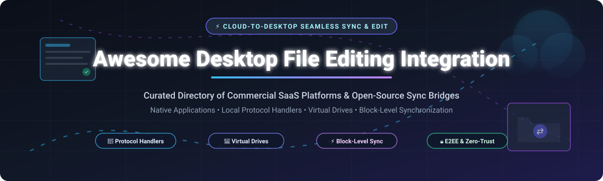

# Awesome-Desktop-File-Editing-Integration 🖥️⚡

  

  
  
  
  
  

---

> 🚀 **Awesome Desktop File Editing Integration** is an authoritative, curated directory and technical guide to desktop-to-cloud file editing bridges, virtual file system drivers, and synchronization clients. It covers both commercial enterprise SaaS platforms and battle-tested open-source software enabling seamless local file editing (Word, Excel, CAD, IDEs, Photoshop) directly from cloud content repositories and web applications.  
> 🌟 **Star this repository** if you find it helpful for your productivity workflows, enterprise architecture, and engineering stack! 🌟

---

## 📋 Table of Contents 📑

- [📈 Sector Overview & Market Dynamics](#-sector-overview--market-dynamics)
- [🟦 SaaS & Hosted Commercial Platforms](#-saas--hosted-commercial-platforms)
  - [Commercial Vendor Feature Deep Dive](#-commercial-vendor-feature-deep-dive)
- [🟩 Open-Source Software](#-open-source-software)
  - [Open-Source Solutions Deep Dive](#-open-source-solutions-deep-dive)
- [📊 Comparison at a Glance](#-comparison-at-a-glance)
- [⭐ Star History](#-star-history)
- [💖 Support & Sponsorship](#-support--sponsorship)
- [🤝 Contributing](#-contributing)
- [📄 License](#-license)

---

## 📈 Sector Overview & Market Dynamics 🌐

The global **Enterprise Content Management (ECM) and Cloud File Collaboration market** is valued at **$28.5 billion in 2024–2025** and is projected to surpass **$65 billion by 2030**, expanding at a compound annual growth rate (CAGR) of over **15%**. This expansion is driven by hybrid and distributed workplace models, the continuous migration of legacy network shares (SMB/NFS) to cloud storage, and demand for zero-trust content governance without losing the power and muscle of local desktop applications (such as Microsoft Office, Autodesk AutoCAD, Adobe Creative Cloud, and code editors).

The sector is **moderately concentrated with winner-take-most dynamics** dominated by ecosystem mega-caps: **Microsoft (OneDrive / Microsoft 365)** and **Alphabet (Google Drive / Workspace)** capture the vast majority of volume tier seats by bundling cloud sync into business productivity suites. Pure-play enterprise content leaders like **Box**, **Dropbox**, and **Atlassian** retain resilient moats through high-assurance compliance, deep protocol integration, and developer ecosystems. Concurrently, an expanding and highly active **open-source ecosystem** (powered by **Syncthing**, **Rclone**, **Nextcloud**, **Cryptomator**, and **WinFsp**) thrives among privacy-conscious enterprises, DevOps teams, and sovereign cloud deployments requiring uncompromised data ownership and air-gapped infrastructure.

---

## 🟦 SaaS & Hosted Commercial Platforms 💼

The table below outlines leading commercial cloud platforms providing native desktop file editing and sync bridges, sorted in **descending order by company scale** (market capitalization or enterprise valuation).

| Platform / Vendor | Company Scale (Valuation / Market Cap) | Starting Tier Pricing | Free Tier & Free Trial Limits | Local Editing Integration Mechanism |
| :--- | :--- | :--- | :--- | :--- |
| **[Microsoft OneDrive / 365](https://www.microsoft.com/microsoft-365/onedrive/online-cloud-storage)** 🏢 | ~$3.1 Trillion (Market Cap) | $5.00 / user / month (Microsoft 365 Business Basic, billed annually) | Free forever: 5 GB cloud storage; 30-day free trial for Microsoft 365 Business Standard (up to 25 users) | Files On-Demand virtual sync client, File Explorer / Finder native integration, Office co-authoring cache |
| **[Google Drive for Desktop](https://workspace.google.com/products/drive/)** 🌐 | ~$2.1 Trillion (Market Cap) | $6.00 / user / month (Google Workspace Business Starter, 1-yr commitment) | Free forever: 15 GB shared storage across Drive/Gmail/Photos; 14-day free trial for Google Workspace | Drive virtual drive mount (G: drive / virtual volume), streaming and mirrored local file cache |
| **[Atlassian Companion](https://www.atlassian.com/software/confluence)** 🛠️ | ~$45 Billion (Market Cap) | $6.05 / user / month (Confluence Cloud Standard; Data Center starts at $27,000/yr for 500 users) | Free forever: Up to 10 users with 2 GB storage on Cloud; 30-day full-feature trial for Confluence Data Center | Custom protocol handler (`atlassian-companion:`), local agent download/watch/re-upload bridge |
| **[Dropbox Desktop](https://www.dropbox.com/)** 📦 | ~$8.5 Billion (Market Cap) | $9.99 / user / month (Dropbox Plus, billed annually) | Free forever: 2 GB storage (up to 3 linked devices); 30-day free trial for Dropbox Business Standard | Smart Sync virtual file streaming, local synced directory with file change listener |
| **[Box Edit / Tools](https://www.box.com/)** 📁 | ~$4.8 Billion (Market Cap) | $15.00 / user / month (Box Business, min. 3 users, billed annually) | Free forever: 10 GB storage with 250 MB single file upload limit; 14-day free trial for Box Business | Box Edit protocol scheme & local daemon bridge, temp file staging with automatic cloud re-upload |
| **[Zoho WorkDrive Desktop](https://www.zoho.com/workdrive/)** 🗄️ | ~$1.2 Billion (Annual Revenue / Private) | $2.50 / user / month (WorkDrive Starter, min. 3 users, billed annually) | Free forever: 5 GB shared team storage (max 3 users); 15-day free trial for WorkDrive Team/Business | TrueSync virtual desktop drive, local file system mounting and on-demand streaming |
| **[Egnyte WebEdit](https://www.egnyte.com/)** 🛡️ | ~$1.0 Billion (Valuation / Private) | $10.00 / user / month (Egnyte Standard Team, billed annually) | Free trial only: 15-day free trial (up to 1 TB storage and 10 users); no free forever plan | WebEdit desktop bridge client, direct browser-to-desktop application launch and lock/unlock synchronization |

---

### Commercial Vendor Feature Deep Dive 🔎

#### Microsoft OneDrive Sync 🏢
* **Type:** Native operating system cloud storage provider & virtual drive engine.
* **Pricing:** $5.00/user/month (Microsoft 365 Business Basic) or $6.00/month (OneDrive for Business Plan 1).
* **Free Tier / Trial:** Free forever: 5 GB storage with personal Microsoft account; 30-day full trial for Microsoft 365 Business Standard.
* **Architecture:** Utilizes Windows Cloud Filter API (`cfapi`) and macOS File Provider extensions to provide *Files On-Demand*. Files appear directly in File Explorer/Finder without using disk space until opened. Deep native integration with Word, Excel, and PowerPoint allows multi-user real-time co-authoring without file locking conflicts.
* **Best For:** Enterprises standardized on Microsoft 365 needing frictionless OS-level desktop file workflows.

#### Google Drive for Desktop 🌐
* **Type:** Virtual drive filesystem streaming client.
* **Pricing:** $6.00/user/month (Google Workspace Business Starter).
* **Free Tier / Trial:** Free forever: 15 GB storage (personal Google account); 14-day free trial for Google Workspace editions.
* **Architecture:** Mounts Google Drive as a separate drive letter (Windows) or volume (macOS). Files stream on-demand or can be mirrored locally for offline availability. Binary files (DWG, PSD, DOCX, ZIP) trigger local associated desktop applications, while native Google Docs open automatically in the default web browser.
* **Best For:** Google Workspace organizations needing native local desktop application access to cloud drive storage.

#### Atlassian Companion 🛠️
* **Type:** Protocol handler bridge application.
* **Pricing:** Confluence Cloud starts at $6.05/user/month; Confluence Data Center starts at $27,000/year (500 users).
* **Free Tier / Trial:** Free forever plan for up to 10 users (Cloud); 30-day evaluation trial license for Confluence Data Center.
* **Architecture:** Listens on custom protocol URI (`atlassian-companion:`). When clicking "Edit with..." in Confluence, the desktop app downloads the file into local temporary cache, invokes the default registered system application (e.g. Word, Excel), monitors file handle mutations via OS file system watchers, and automatically posts multipart PUT uploads back to Confluence upon save.
* **Best For:** Confluence Data Center users requiring native desktop editing of attachments with automated version check-ins.

#### Dropbox Desktop 📦
* **Type:** Block-level bidirectional folder sync & virtual drive client.
* **Pricing:** $9.99/user/month (Dropbox Plus annual) or $15.00/user/month (Dropbox Standard team).
* **Free Tier / Trial:** Free forever: 2 GB personal storage (max 3 devices); 30-day free trial for Dropbox Business.
* **Architecture:** Combines kernel-level file system hooks with smart sync streaming. Downloads file headers as virtual placeholders and fetches data payload upon access. Features proprietary delta-sync algorithms that only transmit byte-level changes of large files rather than full re-uploads.
* **Best For:** Distributed teams seeking battle-tested, ultra-reliable file sync and desktop folder mirroring.

#### Box Edit / Tools 📁
* **Type:** Browser-to-desktop bridging daemon.
* **Pricing:** $15.00/user/month (Box Business, 3-user minimum).
* **Free Tier / Trial:** Free forever: 10 GB storage with 250 MB max file upload size; 14-day free trial for commercial Business plans.
* **Architecture:** Operates a lightweight local daemon communicating over a local loopback web socket / protocol scheme. Intercepts web "Edit" actions, downloads the file to an encrypted local staging folder, opens the native desktop application, and triggers a new Box version upload immediately when the user hits Save.
* **Best For:** Highly regulated enterprise enterprises using Box Governance who need local editing without storing persistent local replicas.

#### Zoho WorkDrive Desktop 🗄️
* **Type:** TrueSync virtual disk filesystem client.
* **Pricing:** $2.50/user/month (Starter tier, annual billing).
* **Free Tier / Trial:** Free forever: 5 GB team storage (3 users max); 15-day free trial for paid WorkDrive plans.
* **Architecture:** Employs *TrueSync* technology to expose enterprise cloud libraries directly within File Explorer and Finder as local filesystem paths. Conserves local disk memory by caching only actively opened files and automatically pushes saves to Zoho cloud.
* **Best For:** Organizations invested in the Zoho enterprise ecosystem seeking cost-effective desktop cloud drive integration.

#### Egnyte WebEdit 🛡️
* **Type:** Enterprise hybrid governance & protocol editing bridge.
* **Pricing:** $10.00/user/month (Standard Team tier, annual billing).
* **Free Tier / Trial:** Free trial only: 15-day full-feature trial (up to 10 users and 1 TB storage); no free-forever tier.
* **Architecture:** Integrates with Egnyte's hybrid cloud storage platform. When triggered from Egnyte's web portal, WebEdit temporarily locks the asset on the cloud, retrieves it locally, launches desktop editors (CAD, Office, specialized software), and automatically uploads the revision while releasing file locks.
* **Best For:** AEC (Architecture, Engineering, Construction) and life sciences firms managing large CAD and BIM files under strict regulatory oversight.

---

## 🟩 Open-Source Software 🔓

Curated list of production-ready, self-hosted, and community-driven desktop file editing, sync, and virtual filesystem mounting solutions. Ranked in **descending order by GitHub_Stars_Count**.

| Project / Software | GitHub_Stars ⭐ | Stack / Tech | License | Primary Architecture & Local Editing Mechanism |
| :--- | :--- | :--- | :--- | :--- |
| **[Syncthing](https://github.com/syncthing/syncthing)** 🔄 |  | Go | MPL-2.0 | Decentralized peer-to-peer continuous block sync engine; edit files natively in synced local directories |
| **[Rclone](https://github.com/rclone/rclone)** ☁️ |  | Go | MIT | Universal cloud storage mount engine (`rclone mount`) presenting 70+ cloud backends as local filesystem drives |
| **[Nextcloud Server](https://github.com/nextcloud/server)** 🌐 |  | PHP / JS / Go | AGPL-3.0 | Comprehensive self-hosted collaboration platform with desktop sync clients and native `nc://` protocol editing |
| **[Cryptomator](https://github.com/cryptomator/cryptomator)** 🔐 |  | Java / C++ | GPL-3.0 | Client-side zero-trust encryption mounting encrypted cloud vaults as native local virtual drives (FUSE / WebDAV) |
| **[Seafile](https://github.com/haiwen/seafile)** 🌊 |  | C / Python / Go | AGPL-3.0 | High-performance block-level file sync server paired with SeaDrive virtual drive for instant local editing |
| **[WinFsp](https://github.com/winfsp/winfsp)** 🪟 |  | C / C++ | GPL-3.0 | Windows File System Proxy (FUSE for Windows); foundational user-mode filesystem driver for cloud desktop mounts |
| **[ownCloud Core](https://github.com/owncloud/core)** ☁️ |  | PHP / Go (Infinite Scale) | AGPL-3.0 | Enterprise content collaboration platform with native desktop sync clients and Collabora/OnlyOffice integration |
| **[SSHFS-Win](https://github.com/winfsp/sshfs-win)** 💻 |  | C | GPL-3.0 | Minimalist SSHFS filesystem driver for Windows using WinFsp to mount remote SFTP servers as local drive letters |
| **[OpenCloud](https://github.com/opencloud-eu/opencloud)** 🚀 |  | Go / Vue | AGPL-3.0 | Ultra-lightweight, high-concurrency cloud sync server focused strictly on fast, reliable desktop folder sync |
| **[SparkleShare](https://github.com/hbons/SparkleShare)** ✨ |  | C# / Mono | GPL-3.0 | Git-backed desktop synchronization tool tracking local directory edits with automated commit and push workflows |
| **[Mutagen](https://github.com/mutagen-io/mutagen)** ⚡ |  | Go | MIT | Real-time, bi-directional low-latency file synchronization designed for remote development and local desktop IDEs |
| **[AeroFTP](https://github.com/axpdev-lab/aeroftp)** 🛰️ |  | Rust / React (Tauri) | GPL-3.0 | Cross-platform multi-protocol client (FTP, SFTP, S3, WebDAV, Cloud) with bidirectional sync & Monaco editor |
| **[Companion4Linux](https://github.com/schorschii/Companion4Linux)** 🐧 |  | Python | GPL-3.0 | Lightweight Linux implementation of Atlassian Companion using `pyinotify` and `atlassian-companion:` scheme |

---

### Open-Source Solutions Deep Dive 🔎

#### Syncthing 🔄
* **Repository:** [syncthing/syncthing](https://github.com/syncthing/syncthing)
* **Stack:** Go | **License:** MPL-2.0
* **Architecture:** Decentralized peer-to-peer file synchronization utilizing the Block Exchange Protocol (BEP). Devices communicate over TLS with cryptographic node IDs. When a user edits files locally with desktop software, Syncthing detects changes via file system notifications and propagates changed blocks directly to authorized peer nodes without intermediate cloud relays.
* **Best For:** Developers, privacy advocates, and distributed organizations needing serverless, private file synchronization across machines.

#### Rclone ☁️
* **Repository:** [rclone/rclone](https://github.com/rclone/rclone)
* **Stack:** Go | **License:** MIT
* **Architecture:** Often called the "Swiss army knife of cloud storage." The `rclone mount` command implements FUSE (on Linux/macOS) and WinFsp (on Windows) to expose over 70 cloud object and storage backends (AWS S3, Google Drive, OneDrive, WebDAV, Dropbox, SFTP) as regular local directories. Users can open and edit files in native local desktop applications with dynamic read-ahead and VFS cache layers.
* **Best For:** Power users and DevOps engineers needing to mount arbitrary remote cloud storage as local drives.

#### Nextcloud Server & Desktop Client 🌐
* **Repository:** [nextcloud/server](https://github.com/nextcloud/server) | [nextcloud/desktop](https://github.com/nextcloud/desktop)
* **Stack:** PHP / JavaScript / Go / C++ (Client) | **License:** AGPL-3.0
* **Architecture:** Features cross-platform desktop synchronization alongside a specialized protocol handler mechanism (`nc://`). When integrated with Nextcloud Web, clicking "Edit locally" triggers the desktop client to download the target file, launch the system's default editor (e.g., LibreOffice, VS Code), lock the remote asset, monitor for file-save events, and re-upload the revised version automatically.
* **Best For:** Organizations seeking a complete self-hosted private cloud alternative to Microsoft 365 or Google Workspace.

#### Cryptomator 🔐
* **Repository:** [cryptomator/cryptomator](https://github.com/cryptomator/cryptomator)
* **Stack:** Java / C++ | **License:** GPL-3.0
* **Architecture:** Provides transparent, client-side zero-knowledge encryption for cloud files. Cryptomator creates encrypted vault directories that sync through conventional cloud tools (Dropbox, OneDrive, Google Drive). When unlocked, it exposes a decrypted virtual drive via Dokany, WinFsp, or WebDAV, allowing users to edit files in any desktop software without ever revealing plaintext keys to cloud providers.
* **Best For:** Security-sensitive professionals and enterprises requiring client-side encryption while maintaining local desktop edit workflows.

#### Seafile 🌊
* **Repository:** [haiwen/seafile](https://github.com/haiwen/seafile)
* **Stack:** C / Python / Go | **License:** AGPL-3.0
* **Architecture:** Employs a Git-like content-addressed file indexing engine that divides files into raw blocks with SHA-1 hashes. The accompanying *SeaDrive* virtual drive client enables on-demand file access directly in File Explorer/Finder, streaming files only when opened by desktop software, and caching modified blocks for instant background synchronization.
* **Best For:** Enterprises and research institutions managing multi-terabyte data libraries who need blazing sync speeds and minimal local disk usage.

#### WinFsp 🪟
* **Repository:** [winfsp/winfsp](https://github.com/winfsp/winfsp)
* **Stack:** C / C++ | **License:** GPL-3.0
* **Architecture:** Windows File System Proxy (WinFsp) provides the core kernel-mode driver and user-mode runtime enabling developers to write fully featured Windows file systems in user space. It powers modern desktop file integration engines (including Rclone, SSHFS-Win, and Cryptomator) to expose cloud and remote network storage as native Windows drives.
* **Best For:** Systems software engineers and tools implementing virtual drives and cloud mounts on Microsoft Windows.

#### ownCloud Core & Infinite Scale ☁️
* **Repository:** [owncloud/core](https://github.com/owncloud/core)
* **Stack:** Go / PHP | **License:** AGPL-3.0 / Apache 2.0
* **Architecture:** The classic PHP core and the modern microservices-based *ownCloud Infinite Scale (oCIS)* written in Go offer enterprise file sync and sharing with granular permissions. The ownCloud desktop client provides virtual file support on Windows and macOS, downloading files only when accessed by desktop applications.
* **Best For:** Enterprises wanting scalable, on-premises cloud file storage with strict data governance policies.

#### SSHFS-Win 💻
* **Repository:** [winfsp/sshfs-win](https://github.com/winfsp/sshfs-win)
* **Stack:** C | **License:** GPL-3.0
* **Architecture:** A port of SSHFS to the Windows platform built atop WinFsp. It maps remote SFTP/SSH directories directly to drive letters (e.g. `Z:`) inside Windows File Explorer, allowing native Windows applications (Notepad++, VS Code, Word) to read and modify remote Linux server files transparently.
* **Best For:** System administrators and engineers editing code and configuration files directly on remote servers.

#### OpenCloud 🚀
* **Repository:** [opencloud-eu/opencloud](https://github.com/opencloud-eu/opencloud)
* **Stack:** Go / Vue | **License:** AGPL-3.0
* **Architecture:** Engineered as a high-performance, single-binary file sync and share solution born out of the ownCloud ecosystem. Replaces heavy web groupware bloat with an uncompromising focus on rapid, rock-solid desktop folder synchronization, public link sharing, and minimal server footprint.
* **Best For:** Teams wanting a lightweight, self-hosted file sync platform that runs efficiently on modest VPS instances.

#### SparkleShare ✨
* **Repository:** [hbons/SparkleShare](https://github.com/hbons/SparkleShare)
* **Stack:** C# / Mono | **License:** GPL-3.0
* **Architecture:** Links a local special folder to remote Git repositories (GitHub, GitLab, self-hosted Git servers). When files within the directory are edited or added by local desktop programs, SparkleShare automatically generates Git commits and pushes changes to the upstream remote branch.
* **Best For:** Designers, technical writers, and developers who value Git-native version control for documents and creative assets.

#### Mutagen ⚡
* **Repository:** [mutagen-io/mutagen](https://github.com/mutagen-io/mutagen)
* **Stack:** Go | **License:** MIT
* **Architecture:** High-performance real-time file synchronization and network forwarding designed specifically for developers. Mutagen watches local project directories and propagates file edits to remote containers, SSH hosts, or cloud development environments in sub-second latency with low CPU and network overhead.
* **Best For:** Engineers editing code in local desktop IDEs (VS Code, JetBrains) while executing code inside remote containers or cloud VMs.

#### AeroFTP 🛰️
* **Repository:** [axpdev-lab/aeroftp](https://github.com/axpdev-lab/aeroftp)
* **Stack:** Rust / React (Tauri) | **License:** GPL-3.0
* **Architecture:** Modern cross-platform file management and sync tool supporting FTP, SFTP, WebDAV, S3, Google Drive, Dropbox, and OneDrive. Features bidirectional file synchronization, AES-256 client encryption, an integrated Monaco code editor, and AI assistant capabilities.
* **Best For:** Power users needing a unified client to manage, sync, and edit remote assets across multi-cloud protocols.

#### Companion4Linux 🐧
* **Repository:** [schorschii/Companion4Linux](https://github.com/schorschii/Companion4Linux)
* **Stack:** Python | **License:** GPL-3.0
* **Architecture:** An open-source Linux client replacing the proprietary Atlassian Companion app. Written in clean Python, it registers the `atlassian-companion:` MIME protocol handler, intercepts download requests from Confluence Data Center, opens the file in local Linux desktop tools (LibreOffice, GIMP), monitors file saves via `pyinotify`, and uploads changes back to Confluence.
* **Best For:** Linux workstations in Confluence Data Center enterprise environments.

---

## 📊 Comparison at a Glance 📋

| Solution | Deployment | License | Integration Paradigm | Free Tier / Trial Bounds | Starting Price | Primary Strength |
| :--- | :--- | :--- | :--- | :--- | :--- | :--- |
| **Microsoft OneDrive** | Cloud SaaS | Commercial | Files On-Demand Virtual Sync | 5 GB Free / 30-Day Trial | $5.00/user/mo | Native Windows/Office ecosystem |
| **Google Drive** | Cloud SaaS | Commercial | Virtual Drive File Streaming | 15 GB Free / 14-Day Trial | $6.00/user/mo | Seamless Workspace web & local mix |
| **Atlassian Companion** | Cloud / DC | Commercial | `atlassian-companion:` Protocol | 10 Users Free / 30-Day Trial | $6.05/user/mo | Confluence document edit & check-in |
| **Dropbox** | Cloud SaaS | Commercial | Smart Sync Virtual Drive | 2 GB Free / 30-Day Trial | $9.99/user/mo | Battle-tested delta block sync |
| **Box Tools / Edit** | Cloud SaaS | Commercial | Staging Daemon & Protocol Bridge | 10 GB Free / 14-Day Trial | $15.00/user/mo | Compliance & governance file lock |
| **Zoho WorkDrive** | Cloud SaaS | Commercial | TrueSync Virtual Drive | 5 GB Free / 15-Day Trial | $2.50/user/mo | Affordable integrated team office suite |
| **Egnyte WebEdit** | Hybrid Cloud | Commercial | WebEdit Daemon & Lock Bridge | 15-Day Trial Only | $10.00/user/mo | AEC & CAD file governance |
| **Syncthing** | Self-Hosted | MPL-2.0 | Continuous P2P Block Sync | 100% Free Open Source | Free | Zero-server peer-to-peer privacy |
| **Rclone** | Self-Hosted | MIT | Virtual FUSE / WinFsp Mount | 100% Free Open Source | Free | Mounts 70+ cloud backends locally |
| **Nextcloud** | Self-Hosted | AGPL-3.0 | Folder Sync + `nc://` Protocol | 100% Free Open Source | Free | Full private cloud collaboration suite |
| **Cryptomator** | Client Tool | GPL-3.0 | Encrypted Virtual Drive Mount | 100% Free Open Source | Free | Client-side zero-knowledge encryption |
| **Seafile** | Self-Hosted | AGPL-3.0 | SeaDrive Block-Level Virtual Drive | 100% Free Open Source | Free | Blazing-fast delta block sync engine |
| **WinFsp** | System Driver| GPL-3.0 | Windows User-Mode Filesystem | 100% Free Open Source | Free | FUSE layer for Windows cloud mounts |
| **ownCloud** | Self-Hosted | AGPL-3.0 | Virtual Files & Sync Engine | 100% Free Open Source | Free | Enterprise data sovereignty |
| **SSHFS-Win** | Client Tool | GPL-3.0 | SFTP Windows Drive Mount | 100% Free Open Source | Free | Mount remote Linux servers via SSH |
| **OpenCloud** | Self-Hosted | AGPL-3.0 | Lightweight Directory Sync | 100% Free Open Source | Free | Focused, lean cloud sync engine |
| **SparkleShare** | Client Tool | GPL-3.0 | Git-Backed Folder Watcher | 100% Free Open Source | Free | Git commit tracking for documents |
| **Mutagen** | Dev Tool | MIT | Low-Latency Dual-Way Sync | 100% Free Open Source | Free | Sub-second sync for remote dev IDEs |
| **AeroFTP** | Client Tool | GPL-3.0 | Multi-Protocol Client & Sync | 100% Free Open Source | Free | Unified multi-cloud file management |
| **Companion4Linux** | Client Tool | GPL-3.0 | Linux Confluence Protocol Bridge | 100% Free Open Source | Free | Lightweight Linux Confluence editing |

---

## ⭐ Star History 📈

---

## 💖 Support & Sponsorship ☕

Thank you so much for exploring **Awesome Desktop File Editing Integration**! Maintaining this comprehensive guide requires ongoing testing, market research, and tracking of emerging open-source and commercial synchronization tools.

If you find this repository valuable:
* ⭐ **Star this repository** to help others in the developer and IT community discover it!
* 🍴 **Fork the repo** and contribute additions, feature fixes, or new projects.
* 📢 **Share this resource** with your engineering team, DevOps peers, and sysadmin colleagues.
* ☕ **Sponsor the maintainer**: Support ongoing independent open-source maintenance via the [GitHub Sponsors Dashboard](https://github.com/sponsors/ishandutta2007). Your generosity makes a huge difference!

---

## 🤝 Contributing 🤝

Contributions and suggestions are warmly encouraged! To propose a new open-source desktop editing bridge, virtual drive driver, or SaaS update:

1. Fork this repository.
2. Ensure any proposed open-source software is actively maintained (commits or releases within the last 12 months) and genuinely open-source.
3. Update the corresponding tables and sections with accurate pricing, licensing, and architectural specifications.
4. Open a descriptive Pull Request detailing your additions.

---

## 📄 License 📜

This curated list is dedicated to the public domain under the [Creative Commons Zero v1.0 Universal (CC0-1.0)](LICENSE) license. All listed third-party trademarks, software names, and logos remain the property of their respective creators and organizations.

---

  <b>⭐ If this guide helped you streamline your cloud-to-desktop file editing workflow, please consider starring this repository! ⭐</b>

